<div align="center">

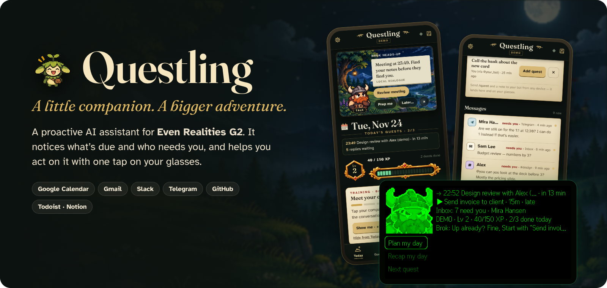

<br>

<a href="#"></a>
<a href="#"></a>
<a href="#"></a>
<a href="#"></a>
<a href="docs/TESTING.md"></a>
<a href="LICENSE"></a>

**[Watch the demo (2:10)](https://youtu.be/RUX4nEEd9Jo)** · **[Try it in 2 minutes](#try-it-in-2-minutes)** · **[How it works](#how-it-works)** · **[Business model](#business-model)** · **[Hackathon](#built-for-heads-up-2026)**

</div>

<br>

Questling is a small companion that lives on your **Even Realities G2** glasses. It notices what's due and who's waiting on you, speaks up at the right moment in its own voice, and helps you act right away: plan the day and book focus time in Google Calendar, answer the Gmail, Slack or Telegram message that's waiting, start a focus session, tick the task off in Todoist. **You confirm every change** before it happens, and the work you finish becomes real RPG progress.

<p align="center">
  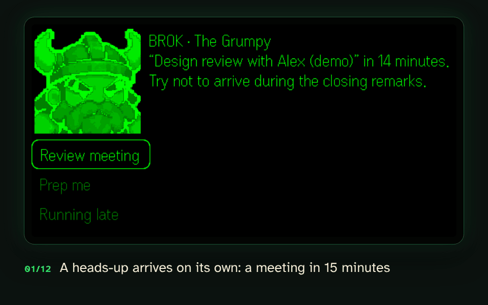
  <br><sub>Real Even Hub SDK screens, captured in the official Even Hub simulator 0.9.5 with demo data.</sub>
</p>

## Why

Assistants live on the phone. You pull it out, scroll a list and lose ten minutes, and nothing notices when you drift or when someone is waiting on you. Reminders feel like spam, so you mute them.

Questling puts **one thing that matters** in front of your eyes, says it in a voice you picked, and lets you act on it with **a tap or a short phrase**.

## What it does

### It speaks up first

A deterministic engine watches your day: a meeting in 15 minutes, an overdue quest, a message from someone who needs you, a free slot to make progress. Heads-ups respect quiet hours, a 20-minute cooldown, a daily cap, snooze and mute. Before a meeting, *Prep me* tells you what it's about and what the other person asked, and *Running late* drafts a note to them for you to confirm.

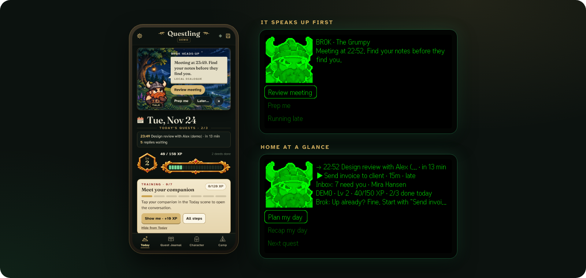

### Plan the day in one tap

*Plan my day* turns your quests, calendar and inbox into a plan: the three things to do, when they fit between meetings, and who is waiting for a reply. *Book focus blocks* puts them all in Google Calendar with **one** confirmation, then reads each block back to verify it.

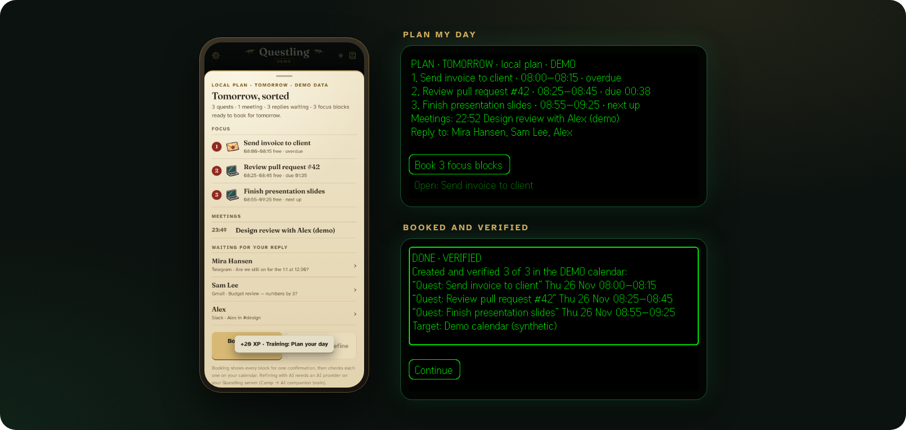

### Answer people without reaching for your phone

Gmail, Slack, Telegram and GitHub in one inbox, sorted by who needs you. Reply with a tap-only quick reply, an AI-written suggestion or your voice. You see the exact words before anything is sent, and Questling checks it arrived. On Telegram it uses **your own bot**, including your private chats through Telegram Business, and anything you send it as `/quest …` becomes a quest.

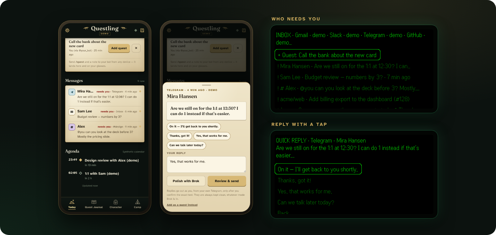

### Stay on track

Start a **focus session** from any quest: a countdown on your glasses, non-urgent heads-ups held back (meetings still come through), then *Done*, *+10 min* or *Stop*. *Catch me up* gives you the state of your day in three lines, and the evening **recap** shows what got done and what slipped.

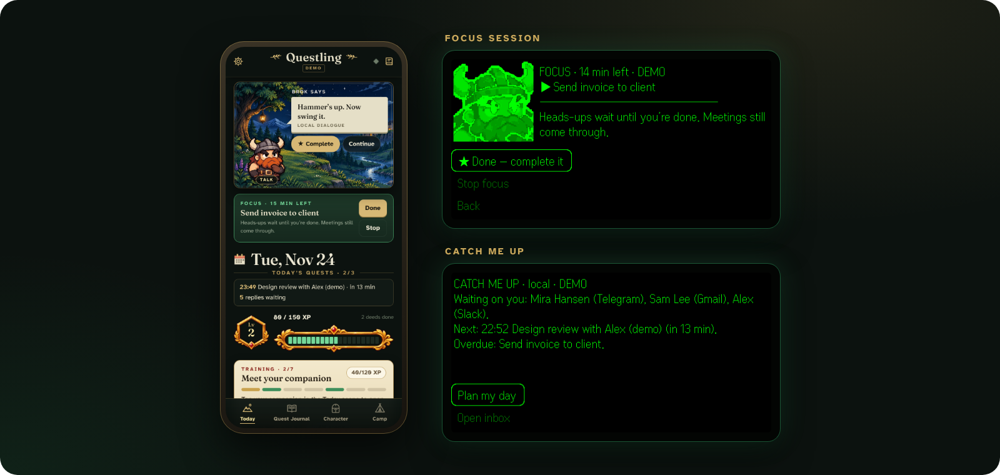

### Ask your notes, skim your channels

**Ask my notes** answers a question from the Notion pages you shared with Questling, such as "What did we decide about pricing?". It reads only the few pages that match and names the page it used. On the glasses you just tap a suggested question (notes about your next meeting or top quests), or ask by voice. *Prep me* offers "Notes for this" before a meeting.

The **channel digest** turns the Telegram channels and groups your bot can read into one line each: what changed, what was decided, who asked for something.

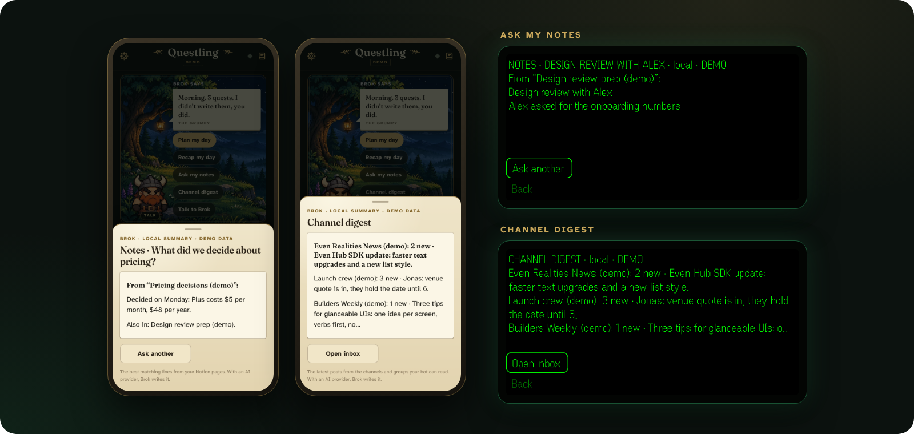

### Real progress for real work

Finished quests give deterministic XP (20 / 40 / 70) across four skills, plus levels, items, achievements and an optional boss campaign. **Training**, under the XP bar, teaches Questling in seven real steps: each one does the thing for real and pays XP once.

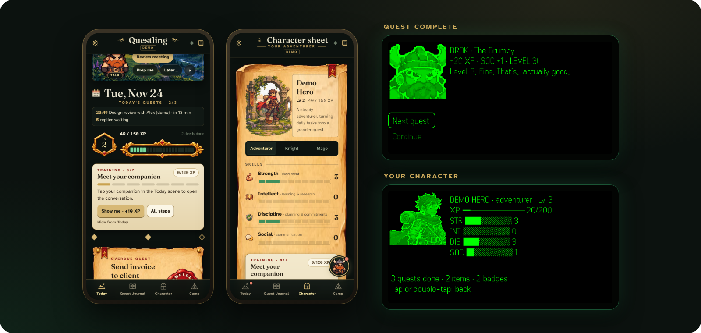

## Meet the companions

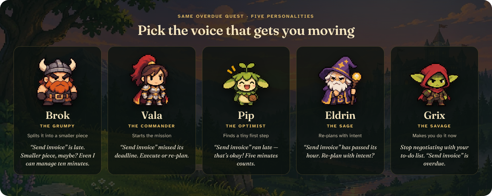

Each companion has 8 expressions, a signature reaction, its own lines for every event and its **own way of solving the same problem**. Grix the Savage also has an optional **18+ Language Mode**, covered under [Safety and privacy](#safety-and-privacy).

## Works with

| Service | Questling reads | Questling writes (only after you confirm) |
|---|---|---|
| **Google Calendar** | Next events and free time | Focus blocks, moving your own events (verified by reading them back) |
| **Gmail** | Sender, subject and date of unread mail (metadata only, never bodies) | Replies to the original sender |
| **Slack** | Messages that @mention you | Thread replies |
| **Telegram** | Your bot's chats, your private chats via Telegram Business, and posts in channels and groups the bot is in (channel digest) | Replies (as you, in Business mode) and `/quest` captures |
| **GitHub** | Review requests, mentions, assignments | Mark as read |
| **Todoist · Notion · Google Tasks** | Open tasks, imported as quests, plus the Notion pages you share (Ask my notes: titles and short excerpts) | Mark done at the source |
| **AI** | Gemini by default; optionally OpenAI, Claude, OpenRouter or Ollama | Only proposes actions. You confirm the exact change |

Everything works without accounts or keys in **demo mode**, which uses clearly labelled synthetic data.

## Safety and privacy

- **No account, no database, no analytics.** Your quests, progress and memory stay on your device.
- **Tokens never reach the app.** You connect on a separate link page with a pairing code, because Google sign-in doesn't work inside the glasses WebView. Tokens stay in the server's memory for at most 12 hours and are never logged.
- **Least privilege.** Calendar asks only for events on calendars you own; Gmail is read as metadata only; GitHub needs only the `notifications` scope.
- **Every write is a proposal.** You see the exact change, confirm it, and Questling verifies it by reading it back. Retries never duplicate anything.
- **AI output is untrusted data.** Responses are schema-validated, the model only sees opaque references, and it can't enable anything by itself.
- **18+ Language Mode** (Grix only) is off by default and needs an adult self-attestation plus an explicit opt-in. It never enables itself from AI output, an import or a link, it turns off instantly, and it never leaks into messages sent for you.

Details in [`SECURITY.md`](SECURITY.md).

## Business model

Your data stays on your device, so Questling sells the **service around the app, not the data**: the AI work (briefings, triage, drafts, notes answers, voice) and a hosted server with ready-made Google, Slack and Notion connections that nobody wants to build themselves.

| Plan | Price | For |
|---|---|---|
| **Free** | $0 | The full app and companions. Bring your own server and AI key (open source) |
| **Questling Plus** | $5 / month · $48 / year | Hosted server, AI allowance, voice, one-tap integrations, shared Telegram bot |
| **Teams** | per seat | Admin controls, SSO, team digests, self-hosted option |
| **Companions & seasons** | small one-time | Extra companions and quest packs |

Payments use signed license keys that the server checks without accounts or user records. They aren't part of this hackathon build. Full plan in [`docs/BUSINESS.md`](docs/BUSINESS.md).

## Try it in 2 minutes

Requirements: Node ≥ 22 and npm ≥ 11 (`npm i -g npm@11`).

```bash
npm ci
npm run dev
```

- **Phone side:** open `http://localhost:5173/?demo=reset` (add `&device=preview` for an in-browser glasses emulator).
- **Glasses side, official simulator:** `npx evenhub-simulator "http://localhost:5173/?demo=reset"`.
- **Real G2:** `npx evenhub qr --url http://<your-LAN-IP>:5173` and scan the code in the Even Realities app.

To use your real accounts, copy `.env.example` to `.env` and follow **[`docs/DEPLOYMENT.md`](docs/DEPLOYMENT.md)**: Gemini, Google OAuth, Slack, Telegram, GitHub and the task lists.

| Script | Purpose |
|---|---|
| `npm run dev` / `npm run demo` | Dev server (client + API on one origin) / open the demo |
| `npm run build` · `npm start` | Production build · production server |
| `npm run typecheck` · `npm run lint` · `npm test` | TypeScript · ESLint + policy checks · Vitest |
| `npm run test:e2e` | Browser end-to-end checks (Playwright) |
| `npm run simulator` · `npm run simulator:auto` | Official simulator · scripted walkthrough with screenshots |
| `npm run pack` | Build `questling-<version>.ehpk` with the official CLI |

## How it works

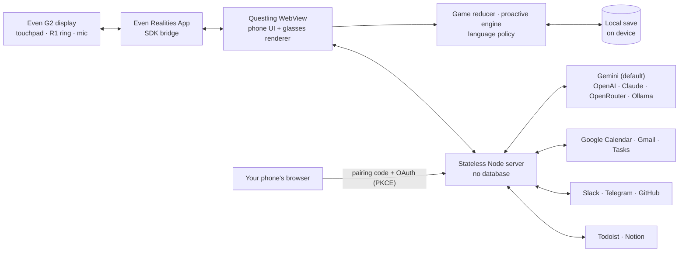

| Folder | What lives there |
|---|---|
| `src/glasses/` | Pure screen builders that produce validated SDK page specs (≤ 12 containers, one capture list, text measured with the official font metrics) |
| `src/device/` | The Even Hub SDK adapter (serialized bridge queue, coalesced renders, in-place text upgrades, audio) and a labelled browser emulator |
| `src/companion/` | Roster, dialogue, the proactive engine, notices and the 18+ language policy |
| `src/game/` | Deterministic reducer, reward ledger, levels, Training, boss campaign |
| `src/app/` | Controller: single-writer store, minimized AI context, proposals with expiry and replay protection, voice, planner |
| `server/` | Stateless API: AI providers, Calendar, mail & chat, task lists, link pages, rate limits, daily budget |
| `tests/` | Unit, integration (with mock provider APIs) and browser end-to-end tests |

## Quality

| Area | How it's checked |
|---|---|
| Glasses UI with the Even Hub SDK | **Official Even Hub simulator 0.9.5**: a 25-step scripted run with 0 errors |
| Phone UI | **33 browser end-to-end checks** |
| Rules, engine, storage, policies, server | **163 unit and integration tests**, including every integration's API flow |
| Your accounts | Connect Google, Slack, Telegram, GitHub, Todoist, Notion and your AI provider in a few minutes ([`docs/DEPLOYMENT.md`](docs/DEPLOYMENT.md)) |

Details in [`docs/TESTING.md`](docs/TESTING.md).

## Built for Heads Up 2026

Built for the **Heads Up: Even Realities Hackathon** (Even Realities × TVM Ventures × Daos Hub, Nov 23–29, 2026). Main track: **04 · AI Assistants & Work** (Google Workspace, with Claude, ChatGPT and OpenRouter as options). Second track: **01 · Messaging & News** (Telegram and Slack in the same flow).

| Judging criterion | Where to look |
|---|---|
| **Usefulness on G2 · 30%** | Glanceable home, proactive heads-ups with *Prep me* and *Running late*, *Plan my day*, *Catch me up*, *Ask my notes*, a channel digest, focus sessions, a triaged inbox. Everything works with swipe and tap; voice is optional |
| **Read and write · 25%** | Reads Calendar, Gmail, Slack, Telegram (including channels), GitHub, task lists and your Notion pages. Writes calendar blocks, replies, task tick-offs and GitHub mark-read, each one an exact, confirm-first proposal that is verified after it runs |
| **Technical execution · 20%** | Real SDK containers verified in the official simulator, 163 tests, 33 browser checks, a stateless server with no database |
| **UX for display and voice · 15%** | 576 × 288 layouts measured with the official font metrics; one idea per screen; tap-only and AI-written quick replies; push-to-talk that never fakes a transcript |
| **Business potential and safety · 10%** | A subscription for the hosted service and AI, plus Teams and one-time companions ([business model](#business-model)). Local-first with no accounts, least-privilege scopes, tokens only in server memory, confirm-before-write, adult mode behind attestation |

**What existed before Nov 23:** a written product plan (working title “LifeQuest”). No code. Everything in this repository was built during the hackathon week.

<details>
<summary><b>More screenshots</b></summary>

<br>

| Phone | | |
|---|---|---|
| 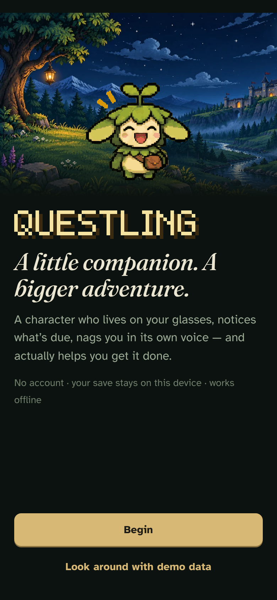 | 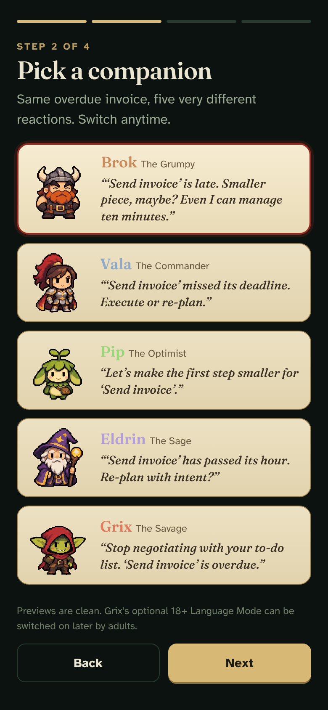 | 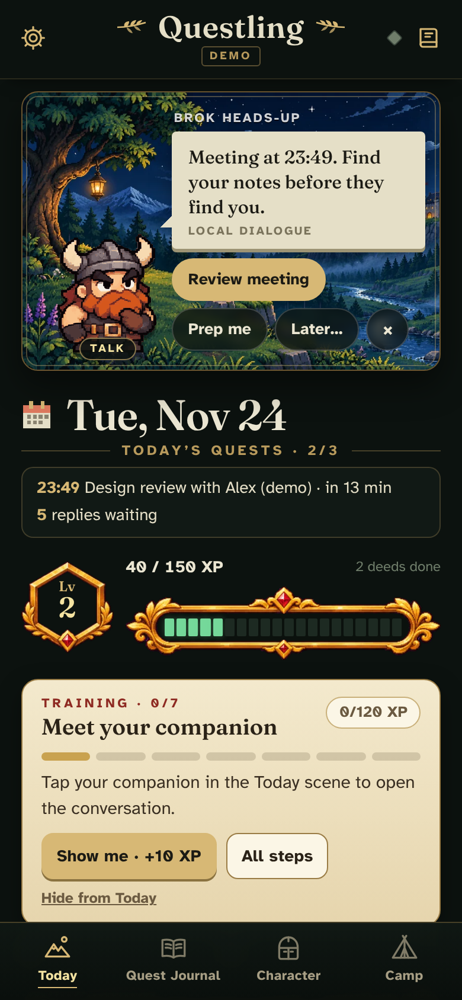 |
| 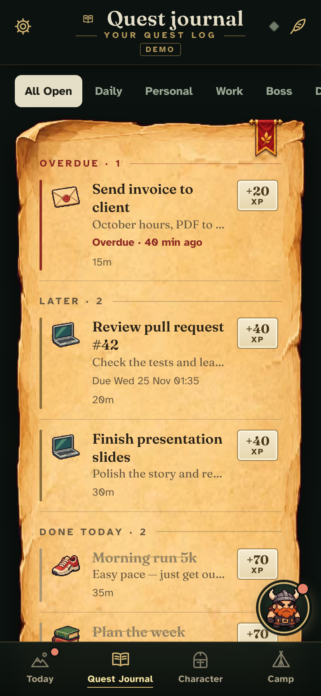 | 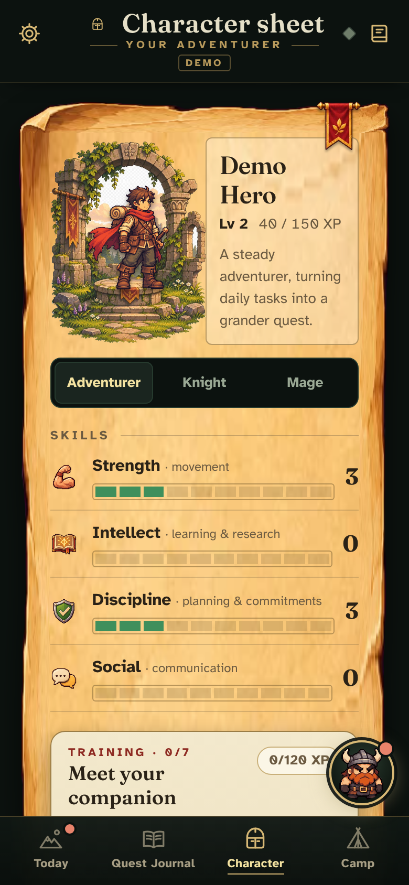 | 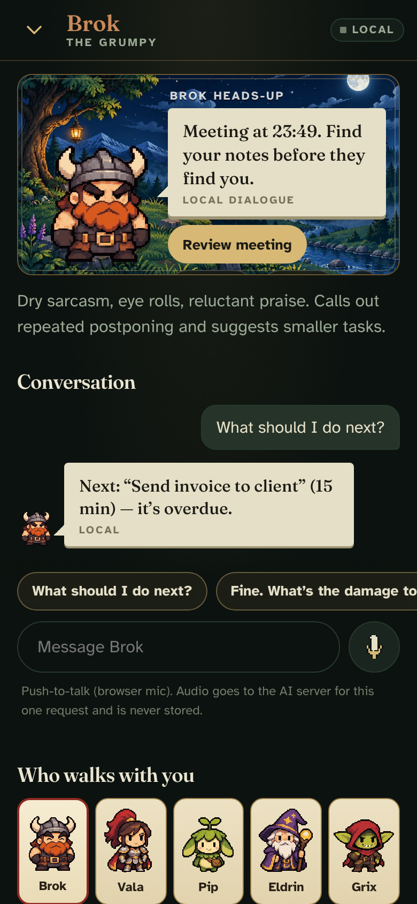 |
| 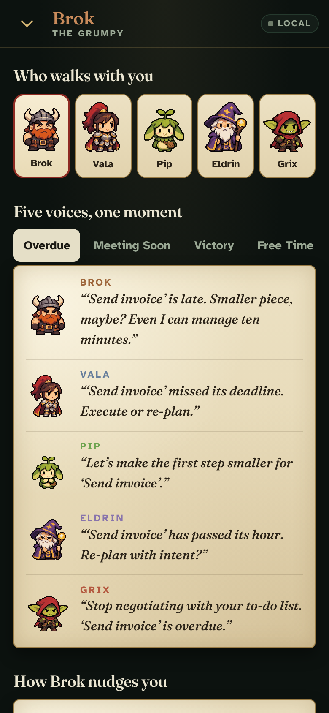 | 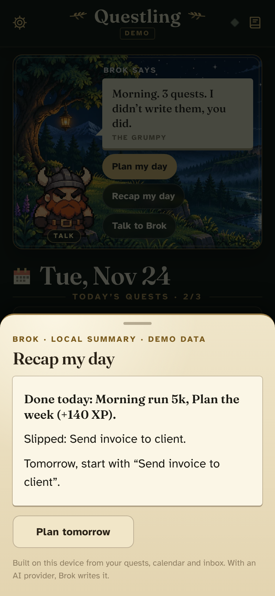 | 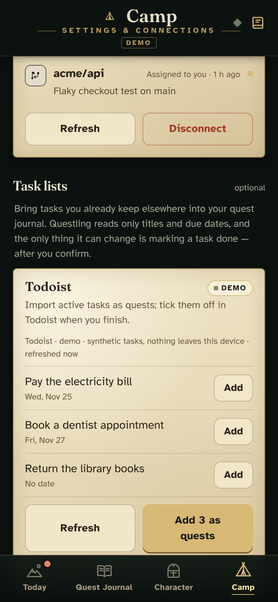 |
| 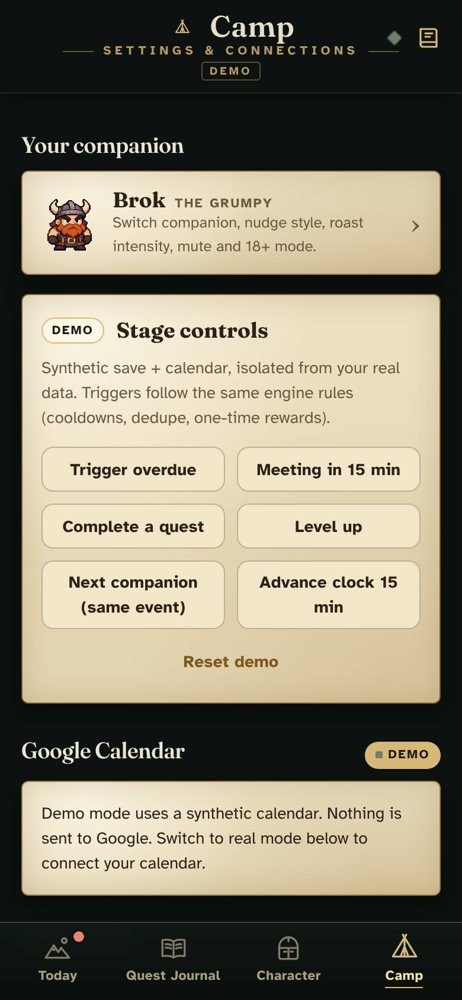 | 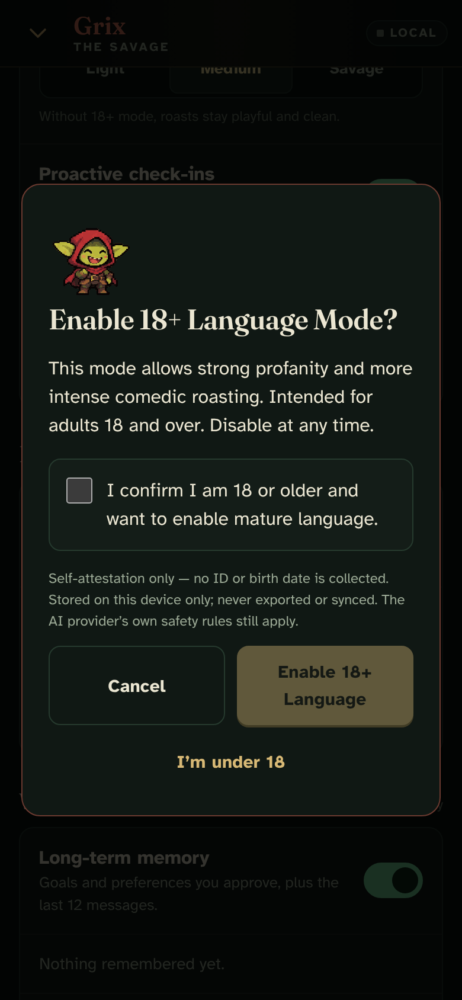 | 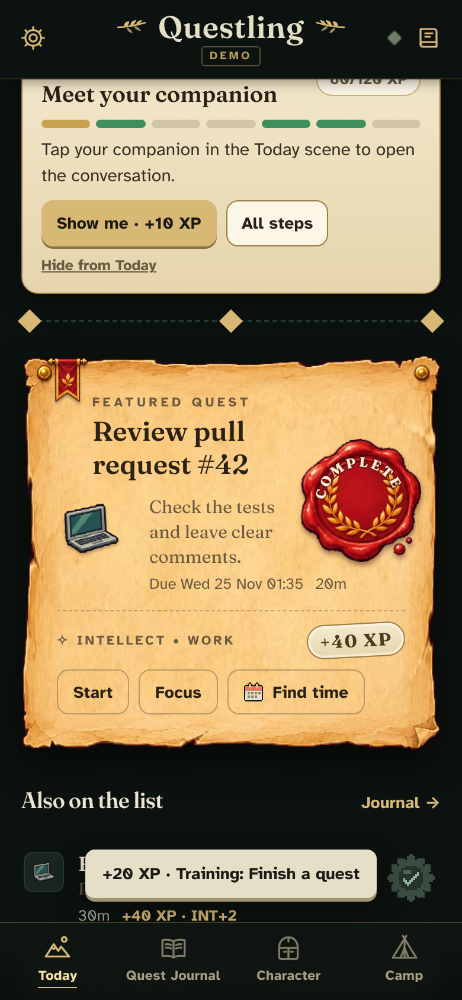 |

| Glasses (official simulator) | |
|---|---|
| 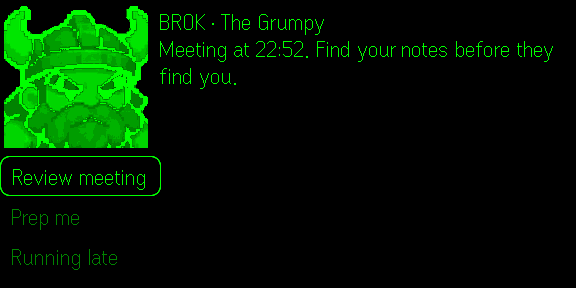 | 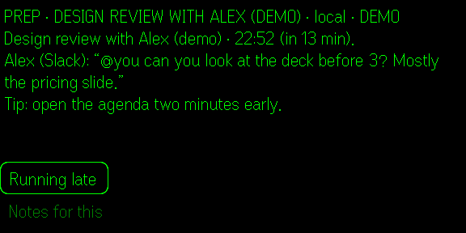 |
| 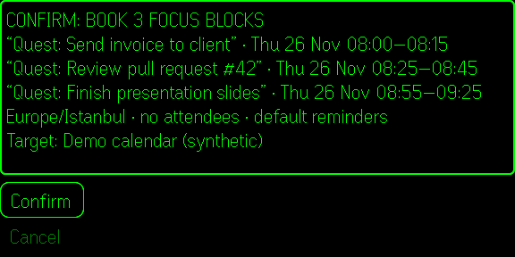 | 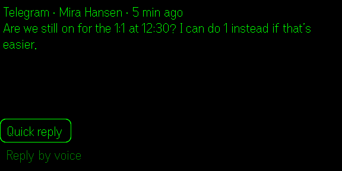 |
| 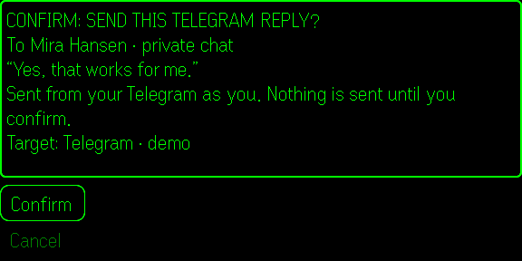 | 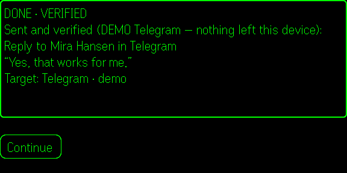 |
| 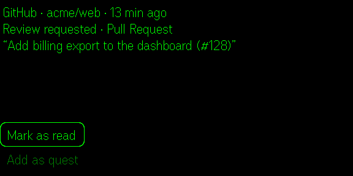 | 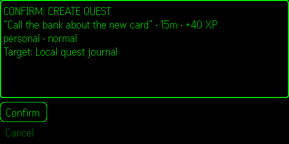 |
| 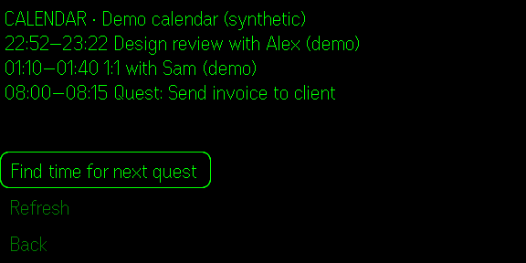 | 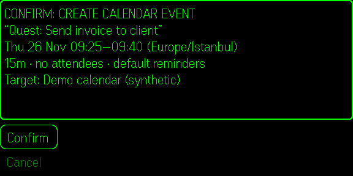 |
| 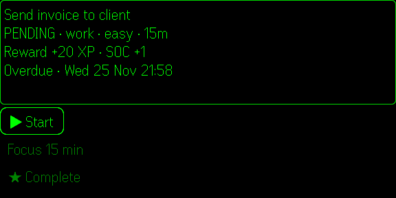 | 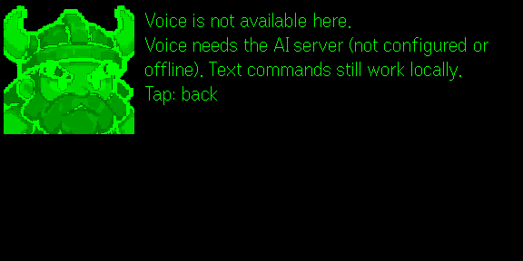 |
| 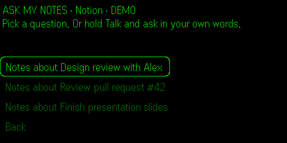 | 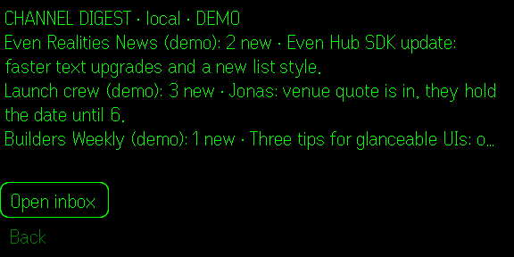 |

</details>

## Credits and license

- **Artwork:** the companion sprites, scenes, item icons, heroes and parchment UI kit were made for Questling and live in `public/assets/` (imported with `scripts/import_sprites.py` and `scripts/import_ui_assets.py`). The glasses variants and small glyphs are generated by `scripts/gen_art.py`.
- **Fonts:** Fraunces and Atkinson Hyperlegible, SIL Open Font License 1.1 (via Fontsource).
- **Built with** the Even Hub SDK, CLI and simulator, React, Zod, `@google/genai`, Vite, Vitest and ESLint.
- **License:** [MIT](LICENSE). “Even Realities” and “G2” are trademarks of their owner. Questling is an independent app and not affiliated with Even Realities.
